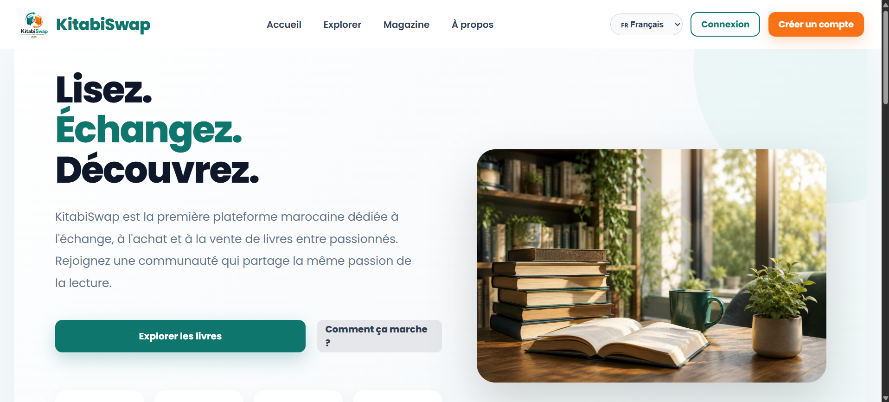
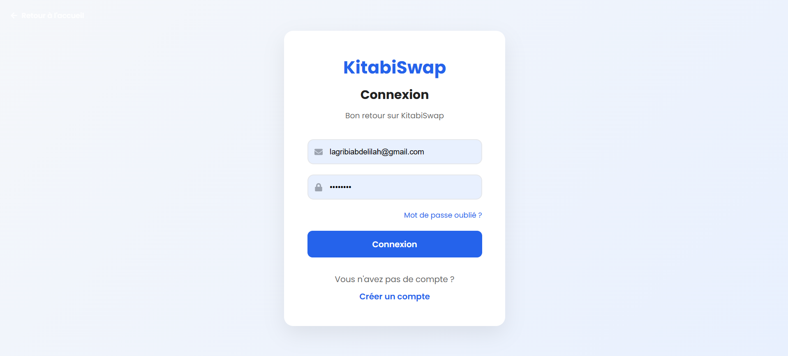
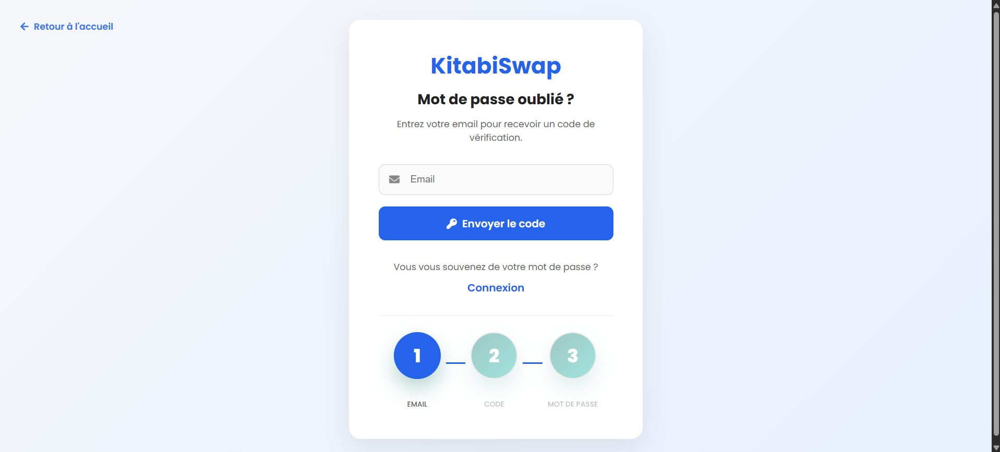

# 📚 KitabiSwap — Book Exchange Platform

**Discover, Share, and Exchange Books.**

KitabiSwap is a web platform designed to make book exchange easier by connecting readers who want to share, discover, and exchange books. The platform aims to encourage reading, promote book reuse, and build a community where knowledge can circulate more easily.

## 📖 Overview

Books are valuable sources of knowledge, but purchasing new books can be expensive, and many books remain unused after being read. KitabiSwap provides a digital space where users can explore available books, publish listings, and connect with other readers interested in exchanging books.

The platform is designed around a simple idea: **give books a second life by making them accessible to more readers.**

## ✨ Key Features

### 👤 User Interface and Navigation
- A home page introducing the platform and its purpose.
- A user-friendly interface for browsing the platform.
- Dedicated pages for exploring books and discovering available listings.
- Navigation designed to provide a clear and accessible user experience.

### 🔐 User Authentication
- Login interface for registered users.
- Account registration interface.
- User access management to support personalized platform experiences.

### 📚 Book Discovery and Listings
- Browse books available on the platform.
- Explore book listings and discover new reading opportunities.
- Provide a foundation for connecting readers with books they are interested in exchanging.

### 🔄 Book Exchange Concept
- Enable users to participate in a community-oriented book exchange experience.
- Support the discovery and management of book listings.
- Encourage reuse, sharing, and more sustainable reading habits.

*Note: The availability of individual features may depend on the current implementation and configuration of the application.*

## ⚙️ How the Platform Works

The intended user journey is organized into the following steps:

1. **Discover the platform:** Visitors access the home page to learn about KitabiSwap.
2. **Create an account or log in:** Users access the authentication pages to enter the platform.
3. **Explore available books:** Users browse listings and discover books that interest them.
4. **Publish or manage listings:** Users can use the relevant listing functionality to make books available to the community, where implemented.
5. **Connect through book exchange:** Users participate in the exchange process according to the platform's available features.
6. **Share knowledge:** Books can reach new readers, helping promote a culture of reading and reuse.

## 🖥️ Screenshots

The following screenshots illustrate the platform's interface.

### Home Page



### Login Page



### Library


### Password Recovery



## 🛠️ Technologies

KitabiSwap is organized as a web application with separate frontend and backend components.

The project structure includes:

- **Frontend:** User interface, navigation, and application pages.
- **Backend:** Server-side functionality and application logic.
- **Database:** Data persistence and management, configured separately from this public repository.
- **Documentation:** Project documentation and supporting resources.
- **Images:** Screenshots used to present the application.

The exact technology stack and dependency versions can be found in the project's `package.json` files and source code.

## 📂 Project Structure

```text
KitabiSwap/
├── backend/       # Server-side application
├── frontend/      # Web application interface

├── images/        # Screenshots for the README
├── .gitignore     # Files excluded from Git
└── README.md      # Project documentation
```

The database directory and private configuration files are intentionally excluded from the public repository.

## 🚀 Getting Started

### Prerequisites

Before running the project, ensure that you have the tools required by its configuration. Depending on the implementation, these may include:

- Node.js and npm
- A compatible database server
- Git
- A modern web browser

### 1. Clone the Repository

```bash
git clone https://github.com/Abdelilah-Lag/KitabiSwap.git
cd KitabiSwap
```

### 2. Install Dependencies

Install the frontend dependencies:

```bash
cd frontend
npm install
```

If the backend has its own `package.json`, install its dependencies separately:

```bash
cd ../backend
npm install
```

### 3. Configure Environment Variables

Check the project's configuration files and environment variable examples before starting the application.

If the backend requires environment variables, create a local `.env` file based on the provided example configuration, if available.

Configure the required database connection and other application settings locally.

**Security:** Never commit `.env` files, database credentials, API keys, JWT secrets, or other sensitive information to a public repository.

### 4. Configure the Database

Configure a compatible database using the application's expected schema and setup instructions.

The private database and its contents are not included in this repository. Database initialization or migration steps depend on the project's implementation.

### 5. Run the Application

Start the frontend using the command configured in its `package.json`. For a typical development setup:

```bash
cd frontend
npm run dev
```

If the backend has a separate development script, start it from another terminal using the script defined in `backend/package.json`, for example:

```bash
cd backend
npm run dev
```

The actual commands, environment variables, and database setup may differ depending on the project's configuration.

## 🔒 Security and Privacy

KitabiSwap is presented through a public source-code repository, while private data and sensitive configuration remain separate.

- Database contents are not published in this repository.
- Environment files containing secrets should remain excluded from Git.
- Credentials and API keys must be stored securely.
- Users should never publish personal information or private records in public project files.

Anyone setting up the application should use their own local configuration and authorized database access.

## 🎯 Project Goals

KitabiSwap aims to:

- Make books easier to discover and exchange.
- Encourage reading and knowledge sharing.
- Reduce unnecessary book waste through reuse.
- Provide a simple digital experience for readers.
- Explore the development of a community-driven book exchange platform.

## 🔮 Future Improvements

Potential future enhancements include:

- Advanced book search and filtering.
- Book categories, genres, and detailed descriptions.
- User profiles and listing management.
- Book exchange requests and status tracking.
- Notifications for exchange-related activities.
- Ratings and reviews.
- Responsive design improvements and accessibility enhancements.

These items represent possible future development directions and are not necessarily implemented in the current version.

## 👨‍💻 Author

**Abdelilah Lagribi**

Engineering student specializing in Artificial Intelligence and Data Science at ENSAM Rabat, Morocco.

For more information about KitabiSwap, its functionality, or potential collaboration opportunities, please contact me by email:

📧 **[lagribiabdelilah@gmail.com](mailto:lagribiabdelilah@gmail.com)**

## 📄 License

No license has been specified yet. Unless a license is added to the repository, the project should not be assumed to be open for unrestricted reuse, modification, or redistribution.

---

**KitabiSwap — Share a book. Discover a story. Spread knowledge.**
